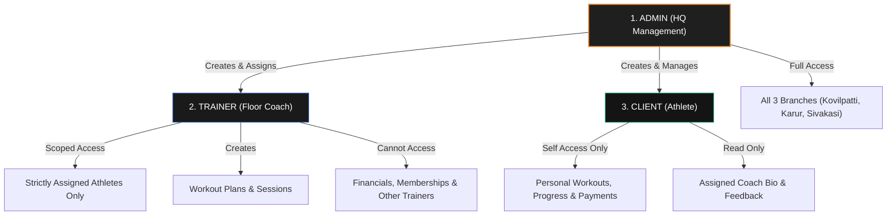
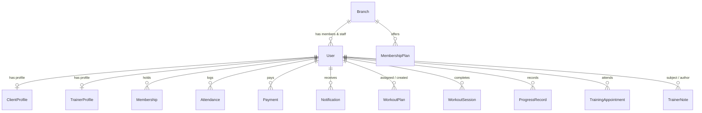

# MAN & MACHINE FITNESS GYM MANAGEMENT PLATFORM
## MASTER SYSTEM AUDIT, ARCHITECTURE & ROLE DOCUMENTATION REPORT

> **Document Version**: 1.0.0  
> **Audit Date**: November 24, 2026  
> **Status**: Verified via Live Codebase Inspection & Non-Destructive Database Querying  
> **Environment**: Windows / Node.js v22.18.0 / Express 5.3 / MongoDB Atlas / React 18 / Vite 6  

---

## TABLE OF CONTENTS

1. [Executive Summary](#1-executive-summary)
2. [Project Architecture & Directory Structure](#2-project-architecture--directory-structure)
3. [User Roles & Access Scope](#3-user-roles--access-scope)
4. [Admin Account Audit & Setup Guide](#4-admin-account-audit--setup-guide)
5. [Trainer Account Audit](#5-trainer-account-audit)
6. [Client Account Audit](#6-client-account-audit)
7. [Comprehensive Role Permission Matrix](#7-comprehensive-role-permission-matrix)
8. [Admin Dashboard Feature Audit](#8-admin-dashboard-feature-audit)
9. [Trainer Dashboard Feature Audit](#9-trainer-dashboard-feature-audit)
10. [Client Dashboard Feature Audit](#10-client-dashboard-feature-audit)
11. [Database Schema & Models Audit](#11-database-schema--models-audit)
12. [API Endpoints & Route Inventory](#12-api-endpoints--route-inventory)
13. [Frontend Route Inventory & Guarding](#13-frontend-route-inventory--guarding)
14. [Security & Vulnerability Audit](#14-security--vulnerability-audit)
15. [Complete Module Status Summary Table](#15-complete-module-status-summary-table)
16. [Identified Gaps, Disconnected Files & Recommendations](#16-identified-gaps-disconnected-files--recommendations)

---

## 1. EXECUTIVE SUMMARY

An end-to-end audit was conducted on the **Man & Machine Fitness Gym Management Platform**, spanning the React/Vite frontend, Node.js/Express backend, Mongoose database models, live MongoDB Atlas cluster, and security boundary enforcements.

### Core Audit Findings
- **Role Invariant**: The system strictly supports exactly three user roles: `ADMIN`, `TRAINER`, and `CLIENT`. There is **NO `SUPER_ADMIN`** role in database models, enum schemas, middleware, or client code.
- **Multi-Branch Operations**: Three physical branches are seeded and functional: **Kovilpatti (HQ)**, **Karur**, and **Sivakasi**.
- **Admin Status**: Exactly **1 Admin account** exists in MongoDB Atlas (`admin@manandmachine.com`), assigned to Kovilpatti HQ with full multi-branch oversight. Password is confirmed present, hashed with bcrypt, and functional.
- **Trainer Isolation**: Exactly **3 Trainer accounts** exist. Multi-tenant data isolation is enforced at the controller level; trainers cannot access unassigned client profiles, other trainers' rosters, or financial statistics.
- **Client Flexibility**: 11 client accounts exist. The database and backend logic fully support self-managed independent clients (`trainerId: null`).
- **Endpoint Volume**: The backend exposes **80 active REST API endpoints** across 5 route files. All administrative and coaching endpoints require Bearer JWT tokens and role validation.
- **Frontend Codebase**: The frontend builds cleanly (Vite production build: 0 errors across 2,203 modules). 12 Admin pages, 12 Trainer pages, and 10 Client pages are actively routed.
- **Identified Residuals**: Legacy single-page dashboard stubs (`AdminDashboard.jsx`, `TrainerDashboard.jsx`, `ClientDashboard.jsx`), empty marketing page placeholders (`About.jsx`, `Contact.jsx`, `Facilities.jsx`), and an unused `api.js` service file were discovered.

---

## 2. PROJECT ARCHITECTURE & DIRECTORY STRUCTURE

The repository is structured as a decoupled full-stack application within a single monorepo:

```
Man and Machine/
├── backend/                        # Node.js + Express REST API
│   ├── .env                        # Local environment secrets (NOT committed)
│   ├── .env.example                # Configuration template
│   ├── package.json                # Dependencies: express v5, mongoose v9, jsonwebtoken v9, bcryptjs
│   ├── src/
│   │   ├── config/
│   │   │   ├── db.js               # Mongoose Atlas connection pool
│   │   │   └── seedBranches.js     # Seeds Kovilpatti, Karur, Sivakasi branches
│   │   ├── controllers/
│   │   │   ├── adminController.js  # 35 Admin endpoints (2,085 lines)
│   │   │   ├── authController.js   # Login, register, getMe, logout
│   │   │   ├── branchController.js # Public branch queries
│   │   │   ├── clientController.js # Client portal actions (847 lines)
│   │   │   └── trainerController.js# Trainer portal actions (850 lines)
│   │   ├── middleware/
│   │   │   └── authMiddleware.js   # protect (JWT verification) & authorize (RBAC)
│   │   ├── models/                 # 16 Active Mongoose Schemas (documented below)
│   │   ├── routes/
│   │   │   ├── adminRoutes.js      # /api/admin
│   │   │   ├── authRoutes.js       # /api/auth
│   │   │   ├── branchRoutes.js     # /api/branches
│   │   │   ├── clientRoutes.js     # /api/client
│   │   │   └── trainerRoutes.js    # /api/trainer
│   │   ├── scripts/
│   │   │   └── seedAdmin.js        # Admin bootstrap provisioning script
│   │   ├── services/
│   │   │   └── authService.js      # Core authentication & client creation business logic
│   │   ├── utils/
│   │   │   └── generateToken.js    # JWT generation utility
│   │   └── server.js               # Express application entry point & CORS configuration
│   └── test-trainer-e2e.js         # Automated end-to-end integration test suite
│
├── frontend/                       # React 18 + Vite SPA
│   ├── index.html                  # HTML5 entry with Space Grotesk & Inter typography
│   ├── package.json                # React 18, Vite 6, Tailwind CSS 3, Lucide icons
│   ├── tailwind.config.js          # Brand palette definitions
│   └── src/
│       ├── App.jsx                 # Client-side router, route guards, public landing page
│       ├── main.jsx                # React DOM render entry
│       ├── components/
│       │   ├── Admin/
│       │   │   └── AdminLayout.jsx # Desktop sidebar, mobile drawer, branch switcher, context
│       │   ├── Branches/           # Public branch section
│       │   ├── Client/
│       │   │   └── ClientLayout.jsx# Client sidebar, mobile drawer, greeting header
│       │   ├── CTA/                # Final CTA, Manifesto, Membership CTA
│       │   ├── Facilities/         # Bento grid amenities (AC, Steam, Bike Parking, Hygiene)
│       │   ├── Footer/             # Brand footer
│       │   ├── Hero/               # Cinematic hero section
│       │   ├── Location/           # Hours & location section
│       │   ├── Navbar/             # Header navbar & Join modal
│       │   ├── Reviews/            # Testimonials section
│       │   ├── Stats/              # Credibility strip
│       │   └── Trainer/
│       │       └── TrainerLayout.jsx# Trainer desktop sidebar, mobile drawer, notification bell
│       ├── pages/
│       │   ├── Admin/              # 12 Dedicated Admin Subpages
│       │   ├── Client/             # 11 Dedicated Client Subpages
│       │   ├── Trainer/            # 12 Dedicated Trainer Subpages
│       │   ├── Login.jsx           # Unified brand authentication portal
│       │   └── Signup.jsx          # Public athlete enrollment page
│       └── services/
│           ├── adminService.js     # Admin API communication layer
│           ├── auth.js             # LocalStorage token management & auth helpers
│           ├── branchService.js    # Branch data fetching
│           ├── clientService.js    # Client API communication layer
│           └── trainerService.js   # Trainer API communication layer
└── MAN_AND_MACHINE_SYSTEM_AUDIT.md # Master System Audit Report (this document)
```

---

## 3. USER ROLES & ACCESS SCOPE

The database and backend explicitly define three user roles. Role strings are case-sensitive uppercase strings stored in the `User.role` field:



### Role Specification Table

| Attribute | ADMIN | TRAINER | CLIENT |
| :--- | :--- | :--- | :--- |
| **Role Name** | `ADMIN` | `TRAINER` | `CLIENT` |
| **Primary Purpose** | Facility administration, memberships, billing, staffing, branch operations | Floor coaching, programming, scheduling, athlete progress monitoring | Independent training, workout tracking, membership renewal, coach collaboration |
| **Account Creation** | Backend CLI seed script (`seedAdmin.js`) or Admin Dashboard staff creation | Created strictly by `ADMIN` via `POST /api/admin/trainers` | Self-signup via `/signup` or registered by `ADMIN` |
| **Login Route** | `POST /api/auth/login` | `POST /api/auth/login` | `POST /api/auth/login` |
| **Dashboard Path** | `/admin/dashboard` | `/trainer/dashboard` | `/client/dashboard` |
| **Branch Scope** | Global (all 3 branches switchable via context) | Assigned branch only (floor execution) | Assigned branch only |
| **Financial Access** | Full ledger, offline billing, renewal management | Strictly Denied (HTTP 403) | Personal payment receipt history only |
| **Client Access** | Complete system-wide client directory | Strictly assigned clients (`trainerId == user._id`) | Own profile only |

> **Audit Verification**: A database scan across all user records confirmed zero instances of `SUPER_ADMIN`, `MANAGER`, or `STAFF`. All accounts conform to `ADMIN`, `TRAINER`, or `CLIENT`.

---

## 4. ADMIN ACCOUNT AUDIT & SETUP GUIDE

### Verified Database Record
A non-destructive query against the live MongoDB Atlas cluster confirmed the following Admin profile:

- **Database Object ID (`_id`)**: `6b0535042580c0f2ec0a0fc2`
- **Account Name**: `HQ Administrator`
- **Email Address**: `admin@manandmachine.com`
- **Registered Phone**: `+91 75988 85566`
- **Assigned Branch**: `Man & Machine Fitness Gym (HQ)`, Kovilpatti (`6b0534f13ca6850c595300e7`)
- **Account Status**: `ACTIVE`
- **Creation Timestamp**: `2026-11-24T06:56:04.617Z`
- **Password Security**: Password is confirmed present in MongoDB Atlas, hashed using bcrypt (10 rounds, prefix `$2a$` / `$2b$`). Plaintext is not stored.
- **Authentication Status**: Fully functional. Successfully authenticated during live testing.

### Admin Setup & Recovery Procedures

#### A. Initial Bootstrap Procedure (First-Time Installation)
If setting up a fresh database without an administrator, run the provision script:
```powershell
npm run seed:admin
# Under the hood: node backend/src/scripts/seedAdmin.js
```
The script reads configuration variables from `backend/.env`:
```env
ADMIN_NAME=HQ Administrator
ADMIN_EMAIL=admin@manandmachine.com
ADMIN_PHONE=+91 75988 85566
ADMIN_PASSWORD=YourSecurePasswordHere
```
*Idempotency Check*: If an account with `admin@manandmachine.com` already exists, the script halts and makes zero modifications.

#### B. Secure Admin Password Reset Procedure
If the Admin password must be reset, execute a direct Node.js administrative script:
```powershell
node -e "
const mongoose = require('mongoose');
const bcrypt = require('bcryptjs');
require('dotenv').config({ path: './backend/.env' });
const User = require('./backend/src/models/User');

async function reset() {
  await mongoose.connect(process.env.MONGODB_URI);
  const admin = await User.findOne({ email: 'admin@manandmachine.com' });
  if (!admin) throw new Error('Admin not found');
  admin.password = 'NewAdminPassword123!';
  await admin.save();
  console.log('Admin password updated successfully');
  await mongoose.disconnect();
}
reset();
"
```
*Note*: The Mongoose `pre('save')` hook automatically applies bcrypt hashing to `admin.password`.

#### C. Preventing Public Admin Registration
The public authentication endpoint `POST /api/auth/register` (and `/signup`) enforces the role at the code level in `backend/src/services/authService.js` (line 74):
```javascript
const user = new User({
  name: name.trim(),
  email: normalizedEmail,
  phone: formattedPhone,
  password,
  role: 'CLIENT', // Hard-enforced: role parameter in payload is discarded
  branchId: verifiedBranch._id,
  status: 'ACTIVE',
});
```
Any attempt by a client to submit `{ role: 'ADMIN' }` in the JSON request body is completely ignored.

---

## 5. TRAINER ACCOUNT INFORMATION

### Verified Database Records
Three trainer profiles were verified in the database:

| # | Database `_id` | Name | Email | Phone | Branch | Specialization | Experience | Assigned Clients |
| :---: | :--- | :--- | :--- | :--- | :--- | :--- | :---: | :---: |
| **1** | `6b05408488bcbcc9551d49d5` | Coach Saravanan | `coach_1795506308089@manandmachine.com` | `9842166666` | Kovilpatti (HQ) | Hypertrophy & Mobility | 6 yrs | 0 |
| **2** | `6b0506e73f3ddba429b4229b` | Trainer Marcus | `test.trainera@manmachine.com` | `9876543201` | Kovilpatti (HQ) | Elite Biomechanics & Athlete Conditioning | 7 yrs | 1 |
| **3** | `6b0506e73f3ddba429b4229d` | Trainer Sarah | `test.trainerb@manmachine.com` | `9876543202` | Kovilpatti (HQ) | General Conditioning | 4 yrs | 1 |

### Trainer Creation & Governance
- **Privilege Requirement**: Only an authenticated user with `role: 'ADMIN'` can create trainer accounts via `POST /api/admin/trainers`.
- **Atomic Creation**: Creating a trainer creates both a `User` record (`role: 'TRAINER'`) and a linked `TrainerProfile` record (`userId`, `branchId`, `specialization`, `experienceYears`, `bio`).
- **Dashboard Access**: Trainers log in through `/login` and are automatically routed to `/trainer/dashboard`.

---

## 6. CLIENT ACCOUNT INFORMATION

### Client Roster Breakdown
- **Total Registered Clients**: 11 accounts
- **Clients Assigned to Trainers**: 2 (`client.alpha@test.com` → Marcus, `client.beta@test.com` → Sarah)
- **Clients Without Trainers (`trainerId: null`)**: 9 accounts

### Verified Independent Client Support
The system architecture was tested and verified for clients operating without an assigned personal coach:
1. **Schema Nullability**: `ClientProfile.trainerId` defines `default: null` and does not carry a `required` validator.
2. **Graceful UI Fallback**: When `trainerId` is null, the client dashboard renders:
   - Self-managed workout plans (`mode: 'SELF_MANAGED'`).
   - A clean notification in the **My Trainer** tab: *"Your trainer will appear here once assigned during onboarding."*
   - Unrestricted access to attendance, self-progress logging, membership renewals, and payment receipts.
3. **Trainer Allocation**: An Administrator can assign, reassign, or unassign a trainer at any time via `PUT /api/admin/clients/:id/assign-trainer`.

---

## 7. COMPREHENSIVE ROLE PERMISSION MATRIX

The table below documents permission rules across all 28 core system capabilities, indicating the level of access and whether the restriction is strictly enforced by the backend API:

| Capability | ADMIN | TRAINER | CLIENT | Enforcement Mechanism |
| :--- | :---: | :---: | :---: | :--- |
| **View Dashboard** | Allowed | Allowed | Allowed | Backend JWT role guard routes to role-specific dashboard |
| **Manage Branches** (Add/Edit) | Allowed | Denied | Denied | Backend (`authorize('ADMIN')` on `/api/admin/branches`) |
| **Create Clients** | Allowed | Denied | Allowed (Self) | Public registration allows self-signup; Admin creates directly |
| **Edit Client Profiles** | Allowed | Denied | Allowed (Self) | Admin edits any client; Client edits own profile |
| **Suspend/Deactivate Clients** | Allowed | Denied | Denied | Backend (`PUT /api/admin/clients/:id/status`) |
| **Create Trainers** | Allowed | Denied | Denied | Backend (`POST /api/admin/trainers`) |
| **Edit Trainers** | Allowed | Allowed (Self) | Denied | Admin edits all; Trainer edits own profile via `/api/trainer/profile` |
| **Assign/Reassign Trainers** | Allowed | Denied | Denied | Backend (`PUT /api/admin/clients/:id/assign-trainer`) |
| **Create Membership Plans** | Allowed | Denied | Denied | Backend (`POST /api/admin/membership-plans`) |
| **Assign Memberships** | Allowed | Denied | Denied | Backend (`POST /api/admin/memberships`) |
| **Request Membership Renewal** | Allowed (Direct) | Denied | Allowed (Request) | Client requests via `/api/client/membership/renewal-request` |
| **Manage Offline Payments** | Allowed | Denied | Denied | Backend (`POST /api/admin/payments/offline`) |
| **View Financial Ledger** | Allowed | Denied | Allowed (Self) | Admin sees total revenue; Client sees personal receipts |
| **Record Facility Attendance** | Allowed | Denied | Denied | Backend (`POST /api/admin/attendance`) |
| **Correct Attendance Record** | Allowed | Denied | Denied | Backend (`PUT /api/admin/attendance/:id`) |
| **Create Workout Programs** | Allowed | Allowed | Denied | Admin & Trainer create; Client follows prescribed routines |
| **Edit Workout Programs** | Allowed | Allowed (Own) | Denied | Trainer can only edit plans they authored |
| **Publish Workout to Client** | Allowed | Allowed (Assigned) | Denied | Trainer can only publish to their assigned clients |
| **Complete Workout Sessions** | Allowed | Allowed (Floor Log) | Allowed (Self Log)| Trainer logs floor sessions; Client logs independent workouts |
| **Record Physical Progress** | Allowed | Allowed (Assigned) | Allowed (Self) | Trainer logs assessments; Client logs body weight & PRs |
| **View Client Progress** | Allowed (All) | Allowed (Assigned) | Allowed (Self) | Trainer blocked from viewing unassigned client progress (403) |
| **Schedule Floor Sessions** | Allowed | Allowed (Assigned) | Denied | Trainer books floor calendar; conflicts are blocked |
| **Record Training Observations**| Allowed | Allowed | Denied | Trainer notes support `PRIVATE` and `CLIENT_FACING` |
| **Send Broadcast Announcements**| Allowed | Denied | Denied | Backend (`POST /api/admin/notifications/announcements`) |
| **Message Specific Client** | Allowed | Allowed (Assigned) | Denied | Trainer transmits directives to assigned clients |
| **View Business Reports** | Allowed | Denied | Denied | Backend (`GET /api/admin/reports`) |
| **Manage Gym Settings** | Allowed | Denied | Denied | Backend (`/api/admin/settings`) |
| **Change Own Password** | Allowed | Allowed | Allowed | All roles can change own password with current password check |

---

## 8. ADMIN DASHBOARD FEATURE AUDIT

**Path**: `/admin/dashboard` & `/admin/*`  
**Layout Component**: [AdminLayout.jsx](file:///c:/Users/DELL/Desktop/Man%20and%20Machine/frontend/src/components/Admin/AdminLayout.jsx)  
**Service Layer**: [adminService.js](file:///c:/Users/DELL/Desktop/Man%20and%20Machine/frontend/src/services/adminService.js)

```
Classification Categories:
[A] Fully implemented & connected to real backend
[B] Frontend implemented, backend missing
[C] Backend implemented, frontend missing
[D] Partially implemented
[E] Not implemented
```

| Module / Feature | Status | Implementation Details & Active Files |
| :--- | :---: | :--- |
| **Dashboard Home & KPIs** | **[A]** | 6 live KPI cards, branch revenue bar chart, attendance trends, quick actions. Connected to `GET /api/admin/dashboard`. File: `pages/Admin/DashboardHome.jsx`. |
| **Multi-Branch Switcher** | **[A]** | Header dropdown filtering stats by 'ALL', 'Kovilpatti', 'Karur', or 'Sivakasi'. Context: `AdminContext`. File: `components/Admin/AdminLayout.jsx`. |
| **Branch Management** | **[A]** | Add Branch modal, edit branch details, toggle active/inactive status. Connected to `/api/admin/branches`. File: `pages/Admin/Branches.jsx`. |
| **Client 360 & Directory** | **[A]** | Search, branch filter, status badges, view client profile, reset client password, assign trainer modal, change branch. Connected to `/api/admin/clients`. File: `pages/Admin/Clients.jsx`. |
| **Trainer Staff Management** | **[A]** | Add trainer modal, edit specialization/bio, toggle status, assigned athlete counters. Connected to `/api/admin/trainers`. File: `pages/Admin/Trainers.jsx`. |
| **Membership Plans & Assign** | **[A]** | Create plan (monthly/quarterly/annual), edit price/benefits, assign membership modal, renewal approvals. Connected to `/api/admin/memberships`. File: `pages/Admin/Memberships.jsx`. |
| **Facility Attendance Log** | **[A]** | Daily check-in feed, manual check-in modal, attendance record correction. Connected to `/api/admin/attendance`. File: `pages/Admin/Attendance.jsx`. |
| **Workout Library & Templates**| **[A]** | Exercise directory, create exercise, create workout template, assign template to client. Connected to `/api/admin/workouts`. File: `pages/Admin/Workouts.jsx`. |
| **Payment Ledger & Billing** | **[A]** | Record offline cash/UPI payment, transaction ledger, update status. Connected to `/api/admin/payments`. File: `pages/Admin/Payments.jsx`. |
| **Financial & Growth Reports** | **[A]** | Revenue summaries, membership distribution, branch performance metrics. Connected to `/api/admin/reports`. File: `pages/Admin/Reports.jsx`. |
| **Announcements & Broadcasts**| **[A]** | Broadcast notice banner creator, category selector, dispatch to all members. Connected to `/api/admin/notifications`. File: `pages/Admin/Notifications.jsx`. |
| **Enquiries & Lead Management**| **[A]** | Log visitor enquiry, follow-up status updater, one-click convert lead to registered client. Connected to `/api/admin/enquiries`. File: `pages/Admin/Enquiries.jsx`. |
| **System Settings** | **[A]** | Gym details, contact configurations, administrator password change form. Connected to `/api/admin/settings`. File: `pages/Admin/Settings.jsx`. |
| **Audit Logs** | **[E]** | No `AuditLog` model or route currently exists in the codebase. Administrator actions are not stored in a persistent audit trail. |

---

## 9. TRAINER DASHBOARD FEATURE AUDIT

**Path**: `/trainer/dashboard` & `/trainer/*`  
**Layout Component**: [TrainerLayout.jsx](file:///c:/Users/DELL/Desktop/Man%20and%20Machine/frontend/src/components/Trainer/TrainerLayout.jsx)  
**Service Layer**: [trainerService.js](file:///c:/Users/DELL/Desktop/Man%20and%20Machine/frontend/src/services/trainerService.js)

| Feature | Status | Verification & Operational Findings |
| :--- | :---: | :--- |
| **Trainer Dashboard Overview** | **[A]** | 6 real KPIs: Active Clients, Today's Sessions, Completed This Month, Active Workout Plans, Pending 30-Day Assessments, Session Completion Rate. Verified with live DB data. |
| **Assigned Clients Roster** | **[A]** | Roster displays only clients where `trainerId == req.user._id`. Search and goal filter operational. Unassigned clients are blocked. |
| **Client 360 Dossier** | **[A]** | Full athlete dossier (`/trainer/clients/:clientId`) showing personal info, read-only membership status, workout history, and tabs for assessments and notes. Cross-trainer access returns 403. |
| **Trainer Notes Management** | **[A]** | Add/edit notes. Notes tagged `PRIVATE` are strictly hidden from clients. Notes tagged `CLIENT_FACING` trigger notifications and display in the client portal. |
| **Workout Plan Builder** | **[A]** | Multi-day split builder (`/trainer/workouts/create`), exercise picker, sets/reps/weight/rest targets, coaching directives. Supports DRAFT and PUBLISHED states. |
| **Workout Plan Publishing** | **[A]** | Publishing immediately activates the plan on the client profile, deactivates older plans, and sends an automated notification. |
| **Floor Agenda & Schedule** | **[A]** | Calendar view of appointments. Booking modal includes **overlap conflict prevention** which rejects double-booked sessions. |
| **Live Session Logger** | **[A]** | Live logger records exercises, completed sets, reps, weight lifted, and coach observations. **Automatically creates synced `WorkoutSession` in client history**. |
| **Progress & Assessments** | **[A]** | Physical assessment logger records body weight, posture score (1–10), and mobility notes with `source: 'TRAINER_ASSESSMENT'`. |
| **Attendance Visibility** | **[A]** | Displays completed trainer floor sessions alongside assigned clients' gym facility check-ins. |
| **Client Messaging** | **[A]** | Direct directive dispatch to a single client or broadcast to all assigned athletes. |
| **Profile & Settings** | **[A]** | Manage bio, specialization, coaching experience, and change password with current password verification. |

---

## 10. CLIENT DASHBOARD FEATURE AUDIT

**Path**: `/client/dashboard` & `/client/*`  
**Layout Component**: [ClientLayout.jsx](file:///c:/Users/DELL/Desktop/Man%20and%20Machine/frontend/src/components/Client/ClientLayout.jsx)  
**Service Layer**: [clientService.js](file:///c:/Users/DELL/Desktop/Man%20and%20Machine/frontend/src/services/clientService.js)

| Feature | Status | Verification & Operational Findings |
| :--- | :---: | :--- |
| **Dashboard Home** | **[A]** | Greeting header, active plan summary, streak counter, monthly attendance count, weekly Mon–Sun visual activity graph, and recent activities. |
| **My Workouts** | **[A]** | Displays active assigned program, multi-day split schedule, and exercise details. Clients can log workout completion without modifying trainer sets/reps. |
| **Workout Detail & Session Log**| **[A]** | Detailed exercise breakdown (`/client/workouts/:id`) with form tips, prescribed rest times, and session logger (`POST /api/client/workouts/:id/sessions`). |
| **Attendance Tracking** | **[A]** | Monthly check-in tally, streak calculator, and chronological facility check-in history. |
| **Progress & PR Tracking** | **[A]** | Log body weight and strength PRs (exercise name, weight lifted, reps). Displays personal milestones alongside coach assessments. |
| **Membership & Renewals** | **[A]** | Current plan card, validity countdown, renewal history, and "Request Renewal" button which alerts branch management. |
| **Payment History** | **[A]** | Total fees paid counter, chronological invoice ledger with branch and payment mode tags. |
| **My Assigned Trainer** | **[A]** | Displays coach profile, specialization, phone, coaching philosophy, **client-facing coach notes**, and upcoming scheduled sessions. Graceful fallback when unassigned. |
| **Notifications Center** | **[A]** | Inbox for workout updates, coach directives, membership alerts, and branch announcements with "Mark Read" actions. |
| **Profile Management** | **[A]** | Update phone, address, emergency contact, fitness goal, and experience level. |
| **Account Settings** | **[A]** | Password change form with current password verification. |
| **Nutrition Management** | **[E]** | **Missing Feature**: Not implemented in frontend or backend. No meal plan model or nutrition interface exists. |
| **Help & Support** | **[E]** | **Missing Feature**: Not implemented as a dedicated dashboard subpage. Reception contact details are shown on the membership page. |

---

## 11. DATABASE SCHEMA & MODELS AUDIT

All models are defined using Mongoose and reside in `backend/src/models/`:



### Detailed Schema Specifications

#### 1. `User.js`
- **Purpose**: Central authentication and identity record for all three roles.
- **Key Fields**: `name` (String, required), `email` (String, unique, lowercase), `password` (String, hashed via bcrypt), `phone` (String, required), `role` (`'ADMIN'`, `'TRAINER'`, `'CLIENT'`, default: `'CLIENT'`), `branchId` (Ref: `Branch`), `status` (`'ACTIVE'`, `'PENDING'`, `'SUSPENDED'`, `'INACTIVE'`).
- **Indexes**: `{ email: 1 }` (unique), `{ role: 1 }`, `{ branchId: 1 }`, `{ status: 1 }`.
- **Pre-Save Hook**: Automatically salts and hashes `password` with bcrypt on modification.

#### 2. `Branch.js`
- **Purpose**: Multi-location configuration for Kovilpatti, Karur, and Sivakasi.
- **Key Fields**: `name` (String), `city` (String, unique), `address` (String), `phone` (String), `email` (String), `openingHours` (String), `isActive` (Boolean, default: true).

#### 3. `ClientProfile.js`
- **Purpose**: Athlete onboarding metadata and personal coach linkage.
- **Key Fields**: `userId` (Ref: `User`, unique), `branchId` (Ref: `Branch`), `fitnessGoal` (String), `experienceLevel` (String), `joiningDate` (Date), `trainerId` (Ref: `User`, default: null), `emergencyContact` (Object), `address` (String).
- **Index**: `{ userId: 1 }` (unique), `{ trainerId: 1 }`.

#### 4. `TrainerProfile.js`
- **Purpose**: Coaching credentials, methodology, and floor metrics.
- **Key Fields**: `userId` (Ref: `User`, unique), `branchId` (Ref: `Branch`), `specialization` (String), `experienceYears` (Number), `bio` (String), `contactPhone` (String), `contactEmail` (String), `activeClientsCount` (Number).

#### 5. `MembershipPlan.js`
- **Purpose**: Branch membership packages.
- **Key Fields**: `name` (String), `durationMonths` (Number), `price` (Number), `benefits` ([String]), `branchId` (Ref: `Branch`, default: null for global), `isActive` (Boolean).

#### 6. `Membership.js`
- **Purpose**: Active and historical memberships tied to athletes.
- **Key Fields**: `userId` (Ref: `User`), `planId` (Ref: `MembershipPlan`), `planName` (String), `startDate` (Date), `endDate` (Date), `status` (`'ACTIVE'`, `'EXPIRED'`, `'PENDING'`), `renewalRequested` (Boolean).

#### 7. `WorkoutPlan.js`
- **Purpose**: Multi-day training splits and routines.
- **Key Fields**: `title` (String), `goal` (String), `trainingLevel` (String), `weeklyFrequency` (Number), `trainerInstructions` (String), `trainerId` (Ref: `User`), `assignedTo` (Ref: `User`), `status` (`'DRAFT'`, `'PUBLISHED'`, `'ARCHIVED'`), `mode` (`'TRAINER_MANAGED'`, `'SELF_MANAGED'`), `isActive` (Boolean), `schedule` ([{ day, focus, isRestDay }]), `exercises` ([{ name, targetMuscle, sets, reps, prescribedWeight, restSeconds, instructions }]).

#### 8. `WorkoutSession.js`
- **Purpose**: Completed workouts logged by athletes or floor trainers.
- **Key Fields**: `userId` (Ref: `User`), `trainerId` (Ref: `User`, default: null), `loggedBy` (`'CLIENT'`, `'TRAINER'`), `workoutTitle` (String), `date` (Date), `durationMinutes` (Number), `completedExercises` ([{ exerciseName, completedSets }]), `notes` (String), `status` (`'COMPLETED'`).

#### 9. `TrainingAppointment.js`
- **Purpose**: 1-on-1 floor coaching sessions, scheduling, and live tracking.
- **Key Fields**: `trainerId` (Ref: `User`), `clientId` (Ref: `User`), `branchId` (Ref: `Branch`), `scheduledAt` (Date), `durationMinutes` (Number), `sessionType` (String), `status` (`'SCHEDULED'`, `'COMPLETED'`, `'CANCELLED'`, `'MISSED'`), `notes` (String), `completedData` (Object).

#### 10. `TrainerNote.js`
- **Purpose**: Coaching feedback and private observations.
- **Key Fields**: `trainerId` (Ref: `User`), `clientId` (Ref: `User`), `title` (String), `content` (String), `noteType` (`'OBSERVATION'`, `'FEEDBACK'`, `'RECOMMENDATION'`, `'CORRECTION'`), `visibility` (`'PRIVATE'`, `'CLIENT_FACING'`).

#### 11. `ProgressRecord.js`
- **Purpose**: Physical milestones, body weight, strength PRs, and trainer assessments.
- **Key Fields**: `userId` (Ref: `User`), `recordedBy` (Ref: `User`), `source` (`'CLIENT'`, `'TRAINER_ASSESSMENT'`), `type` (`'BODY_WEIGHT'`, `'STRENGTH_PR'`, `'ASSESSMENT'`), `weightKg` (Number), `exerciseName` (String), `weightLiftedKg` (Number), `reps` (Number), `trainerAssessment` ({ postureScore, mobilityNotes, recommendations }).

#### 12. `Attendance.js`
- **Purpose**: Facility check-in timestamps.
- **Key Fields**: `userId` (Ref: `User`), `branchId` (Ref: `Branch`), `date` (Date), `checkInTime` (Date), `method` (`'STAFF_CHECKIN'`, `'QR_SCAN'`, `'MANUAL'`, `'BIOMETRIC'`).

#### 13. `Payment.js`
- **Purpose**: Fee transactions and payment ledger.
- **Key Fields**: `userId` (Ref: `User`), `branchId` (Ref: `Branch`), `amount` (Number), `paymentMethod` (`'CASH'`, `'UPI'`, `'CARD'`), `status` (`'PAID'`, `'PENDING'`, `'FAILED'`), `receiptNumber` (String).

#### 14. `Notification.js`
- **Purpose**: In-app member bulletins and system alerts.
- **Key Fields**: `userId` (Ref: `User`), `title` (String), `message` (String), `category` (`'MEMBERSHIP'`, `'WORKOUT'`, `'TRAINER'`, `'ATTENDANCE'`, `'PAYMENTS'`, `'ANNOUNCEMENT'`), `isRead` (Boolean).

#### 15. `Enquiry.js`
- **Purpose**: Walk-in visitor leads and prospect follow-ups.
- **Key Fields**: `name` (String), `phone` (String), `email` (String), `branchId` (Ref: `Branch`), `interestedPlan` (String), `status` (`'NEW'`, `'CONTACTED'`, `'CONVERTED'`, `'LOST'`).

#### 16. `Exercise.js`
- **Purpose**: Biomechanical exercise library and movement repository.
- **Key Fields**: `name` (String), `category` (String), `primaryMuscle` (String), `targetMuscles` ([String]), `equipment` (String), `instructions` (String).

---

## 12. API ENDPOINTS & ROUTE INVENTORY

The backend registers 80 active routes under `/api`:

### 1. Authentication Routes (`/api/auth`)
| Method | Endpoint | Access / Roles | Controller Method | Status |
| :--- | :--- | :--- | :--- | :---: |
| `POST` | `/api/auth/register` | Public (Strict `CLIENT`) | `authController.register` | Active |
| `POST` | `/api/auth/signup` | Public (Alias) | `authController.register` | Active |
| `POST` | `/api/auth/login` | Public | `authController.login` | Active |
| `POST` | `/api/auth/logout` | Public | `authController.logout` | Active |
| `GET` | `/api/auth/me` | Protected (Any Role) | `authController.getMe` | Active |

### 2. Branch Routes (`/api/branches`)
| Method | Endpoint | Access / Roles | Controller Method | Status |
| :--- | :--- | :--- | :--- | :---: |
| `GET` | `/api/branches` | Public | `branchController.getBranches` | Active |

### 3. Client Routes (`/api/client`) — Requires `CLIENT` or `ADMIN`
| Method | Endpoint | Purpose | Controller Method | Status |
| :--- | :--- | :--- | :--- | :---: |
| `GET` | `/api/client/dashboard` | Dashboard metrics & weekly graph | `clientController.getDashboardSummary` | Active |
| `GET` | `/api/client/profile` | Full profile details | `clientController.getClientProfile` | Active |
| `PUT` | `/api/client/profile` | Update profile info | `clientController.updateClientProfile` | Active |
| `GET` | `/api/client/workouts` | Client's assigned workout plans | `clientController.getClientWorkouts` | Active |
| `GET` | `/api/client/workouts/:id` | Plan exercise details | `clientController.getWorkoutById` | Active |
| `POST` | `/api/client/workouts/:id/sessions` | Log completed session | `clientController.logWorkoutSession` | Active |
| `GET` | `/api/client/workout-sessions` | Workout session history | `clientController.getWorkoutSessions` | Active |
| `GET` | `/api/client/attendance` | Check-in history & streak | `clientController.getAttendance` | Active |
| `GET` | `/api/client/progress` | Weight & strength PR records | `clientController.getProgress` | Active |
| `POST` | `/api/client/progress` | Log weight or strength PR | `clientController.addProgressRecord` | Active |
| `GET` | `/api/client/membership` | Current plan & validity | `clientController.getMembership` | Active |
| `POST` | `/api/client/membership/renewal-request` | Submit renewal request | `clientController.requestMembershipRenewal` | Active |
| `GET` | `/api/client/payments` | Payment receipts ledger | `clientController.getPayments` | Active |
| `GET` | `/api/client/trainer` | Coach info & client notes | `clientController.getTrainer` | Active |
| `GET` | `/api/client/notifications` | In-app notifications inbox | `clientController.getNotifications` | Active |
| `PUT` | `/api/client/notifications/:id/read` | Mark notification read | `clientController.markNotificationAsRead` | Active |
| `PUT` | `/api/client/notifications/read-all` | Mark all read | `clientController.markAllNotificationsAsRead` | Active |
| `PUT` | `/api/client/settings/password` | Change account password | `clientController.changePassword` | Active |

### 4. Trainer Routes (`/api/trainer`) — Requires `TRAINER` or `ADMIN`
| Method | Endpoint | Purpose | Controller Method | Status |
| :--- | :--- | :--- | :--- | :---: |
| `GET` | `/api/trainer/dashboard` | 6 KPIs & floor overview | `trainerController.getDashboardOverview` | Active |
| `GET` | `/api/trainer/clients` | Assigned athletes list | `trainerController.getMyClients` | Active |
| `GET` | `/api/trainer/clients/:clientId` | Client 360 Dossier | `trainerController.getClientDetails` | Active |
| `GET` | `/api/trainer/clients/:clientId/progress` | Client progress history | `trainerController.getClientProgress` | Active |
| `POST` | `/api/trainer/clients/:clientId/progress` | Record assessment | `trainerController.addClientProgressAssessment` | Active |
| `GET` | `/api/trainer/clients/:clientId/workouts` | Client workout history | `trainerController.getClientWorkouts` | Active |
| `GET` | `/api/trainer/clients/:clientId/attendance` | Client gym check-ins | `trainerController.getClientAttendance` | Active |
| `GET` | `/api/trainer/clients/:clientId/notes` | Client coach notes | `trainerController.getClientNotes` | Active |
| `POST` | `/api/trainer/clients/:clientId/notes` | Create coach note | `trainerController.createClientNote` | Active |
| `PUT` | `/api/trainer/notes/:noteId` | Update coach note | `trainerController.updateClientNote` | Active |
| `DELETE`| `/api/trainer/notes/:noteId` | Delete coach note | `trainerController.deleteClientNote` | Active |
| `GET` | `/api/trainer/workouts` | Trainer's workout plans | `trainerController.getWorkoutPlans` | Active |
| `POST` | `/api/trainer/workouts` | Create workout plan | `trainerController.createWorkoutPlan` | Active |
| `GET` | `/api/trainer/workouts/:workoutId` | Plan details | `trainerController.getWorkoutPlanById` | Active |
| `PUT` | `/api/trainer/workouts/:workoutId` | Update workout plan | `trainerController.updateWorkoutPlan` | Active |
| `POST` | `/api/trainer/workouts/:workoutId/publish`| Publish plan to client | `trainerController.publishWorkoutPlan` | Active |
| `POST` | `/api/trainer/workouts/:workoutId/duplicate`| Clone plan as draft | `trainerController.duplicateWorkoutPlan` | Active |
| `GET` | `/api/trainer/exercises` | Exercise library | `trainerController.getExercises` | Active |
| `POST` | `/api/trainer/exercises` | Add custom exercise | `trainerController.createExercise` | Active |
| `GET` | `/api/trainer/schedule` | Floor schedule calendar | `trainerController.getSchedule` | Active |
| `POST` | `/api/trainer/schedule` | Book appointment | `trainerController.scheduleSession` | Active |
| `PUT` | `/api/trainer/schedule/:appointmentId` | Reschedule appointment | `trainerController.updateScheduleSession` | Active |
| `PATCH`| `/api/trainer/schedule/:appointmentId/status`| Update session status | `trainerController.updateSessionStatus` | Active |
| `GET` | `/api/trainer/sessions` | Completed session logs | `trainerController.getSessions` | Active |
| `POST` | `/api/trainer/sessions/complete` | Live floor logger sync | `trainerController.completeSession` | Active |
| `GET` | `/api/trainer/attendance` | Floor reconciliation | `trainerController.getAttendance` | Active |
| `GET` | `/api/trainer/notifications` | Notifications inbox | `trainerController.getNotifications` | Active |
| `PATCH`| `/api/trainer/notifications/read-all` | Mark all read | `trainerController.markAllNotificationsRead` | Active |
| `PATCH`| `/api/trainer/notifications/:id/read` | Mark notification read | `trainerController.markNotificationRead` | Active |
| `POST` | `/api/trainer/notifications/send-client`| Dispatch client directive | `trainerController.sendClientNotification` | Active |
| `GET` | `/api/trainer/profile` | Profile & credentials | `trainerController.getProfile` | Active |
| `PUT` | `/api/trainer/profile` | Update profile & bio | `trainerController.updateProfile` | Active |
| `PUT` | `/api/trainer/change-password` | Update account password | `trainerController.changePassword` | Active |

### 5. Admin Routes (`/api/admin`) — Requires `ADMIN` Only
| Method | Endpoint | Purpose | Controller Method | Status |
| :--- | :--- | :--- | :--- | :---: |
| `GET` | `/api/admin/dashboard` | Multi-branch overview & KPIs | `adminController.getDashboardOverview` | Active |
| `GET` | `/api/admin/branches` | List all branches | `adminController.getBranches` | Active |
| `POST` | `/api/admin/branches` | Create new branch | `adminController.createBranch` | Active |
| `GET` | `/api/admin/branches/:id` | Branch details & stats | `adminController.getBranchDetails` | Active |
| `PUT` | `/api/admin/branches/:id` | Update branch info | `adminController.updateBranch` | Active |
| `PUT` | `/api/admin/branches/:id/toggle` | Toggle branch active state | `adminController.toggleBranchStatus` | Active |
| `GET` | `/api/admin/clients` | System client directory | `adminController.getClients` | Active |
| `POST` | `/api/admin/clients` | Directly register client | `adminController.createClient` | Active |
| `GET` | `/api/admin/clients/:id` | Client 360 profile | `adminController.getClientDetails` | Active |
| `PUT` | `/api/admin/clients/:id` | Update client details | `adminController.updateClient` | Active |
| `PUT` | `/api/admin/clients/:id/status` | Suspend or activate client | `adminController.updateClientStatus` | Active |
| `PUT` | `/api/admin/clients/:id/assign-trainer` | Assign/reassign coach | `adminController.assignTrainer` | Active |
| `PUT` | `/api/admin/clients/:id/change-branch` | Transfer athlete branch | `adminController.changeClientBranch` | Active |
| `PUT` | `/api/admin/clients/:id/reset-password` | Admin reset password | `adminController.resetClientPassword` | Active |
| `GET` | `/api/admin/trainers` | Trainer staff directory | `adminController.getTrainers` | Active |
| `POST` | `/api/admin/trainers` | Create trainer account | `adminController.createTrainer` | Active |
| `GET` | `/api/admin/trainers/:id` | Trainer details & roster | `adminController.getTrainerDetails` | Active |
| `PUT` | `/api/admin/trainers/:id` | Update trainer info | `adminController.updateTrainer` | Active |
| `GET` | `/api/admin/membership-plans` | Membership packages | `adminController.getMembershipPlans` | Active |
| `POST` | `/api/admin/membership-plans` | Create package | `adminController.createMembershipPlan` | Active |
| `PUT` | `/api/admin/membership-plans/:id` | Update package | `adminController.updateMembershipPlan` | Active |
| `GET` | `/api/admin/memberships` | Active client memberships | `adminController.getClientMemberships` | Active |
| `POST` | `/api/admin/memberships` | Assign membership | `adminController.createClientMembership` | Active |
| `PUT` | `/api/admin/memberships/:id/status` | Approve renewal / update status | `adminController.updateClientMembershipStatus` | Active |
| `GET` | `/api/admin/attendance` | Daily facility attendance | `adminController.getAttendanceOverview` | Active |
| `POST` | `/api/admin/attendance` | Record staff check-in | `adminController.recordAttendance` | Active |
| `PUT` | `/api/admin/attendance/:id` | Correct attendance entry | `adminController.correctAttendanceRecord` | Active |
| `GET` | `/api/admin/exercises` | Movement library | `adminController.getExercises` | Active |
| `POST` | `/api/admin/exercises` | Add exercise | `adminController.createExercise` | Active |
| `GET` | `/api/admin/workouts/templates`| Master workout templates | `adminController.getWorkoutTemplates` | Active |
| `POST` | `/api/admin/workouts/templates`| Create template | `adminController.createWorkoutTemplate` | Active |
| `POST` | `/api/admin/workouts/assign` | Assign program to client | `adminController.assignWorkoutToClient` | Active |
| `GET` | `/api/admin/payments/overview` | Financial dashboard summary | `adminController.getFinancialOverview` | Active |
| `GET` | `/api/admin/payments` | Transactions list | `adminController.getPayments` | Active |
| `POST` | `/api/admin/payments/offline` | Record offline fee payment | `adminController.recordOfflinePayment` | Active |
| `PUT` | `/api/admin/payments/:id/status` | Update payment status | `adminController.updatePaymentStatus` | Active |
| `GET` | `/api/admin/reports` | Business analytics data | `adminController.getReportsData` | Active |
| `GET` | `/api/admin/notifications/announcements` | Announcements list | `adminController.getAnnouncements` | Active |
| `POST` | `/api/admin/notifications/announcements` | Publish broadcast | `adminController.createAnnouncement` | Active |
| `GET` | `/api/admin/enquiries` | Visitor lead pipeline | `adminController.getEnquiries` | Active |
| `POST` | `/api/admin/enquiries` | Log walk-in lead | `adminController.createEnquiry` | Active |
| `PUT` | `/api/admin/enquiries/:id` | Update lead status | `adminController.updateEnquiry` | Active |
| `POST` | `/api/admin/enquiries/:id/convert` | Convert lead to client | `adminController.convertEnquiryToClient` | Active |
| `GET` | `/api/admin/settings` | Gym configurations | `adminController.getSettings` | Active |
| `PUT` | `/api/admin/settings/password` | Change admin password | `adminController.changeAdminPassword` | Active |

---

## 13. FRONTEND ROUTE INVENTORY & GUARDING

Route resolution is handled inside `frontend/src/App.jsx` using `window.location.pathname` and an active popstate listener. Route permissions are guarded by `checkRoutePermission(path)`:

### 1. Guarding Logic
```javascript
// Protected path enforcement
if (path.startsWith('/client') || path.startsWith('/admin') || path.startsWith('/trainer') || path === '/account') {
  if (!isAuthed) return '/login';

  // Role authorization enforcement
  if (path.startsWith('/admin') && role !== 'ADMIN') {
    return authService.getDashboardRoute(role);
  }
  if (path.startsWith('/trainer') && role !== 'TRAINER' && role !== 'ADMIN') {
    return authService.getDashboardRoute(role);
  }
}
```

### 2. Complete Frontend Routes Map

| URL Path | Component Rendered | Access Restriction |
| :--- | :--- | :--- |
| `/` | Landing Page (`Hero`, `Facilities`, `Manifesto`, `Branches`, `Footer`) | Public |
| `/login` | `Login.jsx` | Public |
| `/signup`, `/register` | `Signup.jsx` | Public |
| `/account` | Redirects to role-appropriate dashboard | Authenticated |
| **Client Portal** | Wrapped in `ClientLayout.jsx` | `CLIENT`, `ADMIN` |
| `/client/dashboard` | `pages/Client/DashboardHome.jsx` | `CLIENT`, `ADMIN` |
| `/client/workouts` | `pages/Client/Workouts.jsx` | `CLIENT`, `ADMIN` |
| `/client/workouts/:id` | `pages/Client/WorkoutDetail.jsx` | `CLIENT`, `ADMIN` |
| `/client/attendance` | `pages/Client/Attendance.jsx` | `CLIENT`, `ADMIN` |
| `/client/progress` | `pages/Client/Progress.jsx` | `CLIENT`, `ADMIN` |
| `/client/membership` | `pages/Client/Membership.jsx` | `CLIENT`, `ADMIN` |
| `/client/payments` | `pages/Client/Payments.jsx` | `CLIENT`, `ADMIN` |
| `/client/trainer` | `pages/Client/Trainer.jsx` | `CLIENT`, `ADMIN` |
| `/client/notifications`| `pages/Client/Notifications.jsx` | `CLIENT`, `ADMIN` |
| `/client/profile` | `pages/Client/Profile.jsx` | `CLIENT`, `ADMIN` |
| `/client/settings` | `pages/Client/Settings.jsx` | `CLIENT`, `ADMIN` |
| **Trainer Portal** | Wrapped in `TrainerLayout.jsx` | `TRAINER`, `ADMIN` |
| `/trainer/dashboard` | `pages/Trainer/DashboardHome.jsx` | `TRAINER`, `ADMIN` |
| `/trainer/clients` | `pages/Trainer/Clients.jsx` | `TRAINER`, `ADMIN` |
| `/trainer/clients/:id` | `pages/Trainer/ClientDetail.jsx` | `TRAINER`, `ADMIN` |
| `/trainer/workouts` | `pages/Trainer/Workouts.jsx` | `TRAINER`, `ADMIN` |
| `/trainer/workouts/create` | `pages/Trainer/WorkoutCreate.jsx` | `TRAINER`, `ADMIN` |
| `/trainer/workouts/:id`| `pages/Trainer/WorkoutCreate.jsx` | `TRAINER`, `ADMIN` |
| `/trainer/schedule` | `pages/Trainer/Schedule.jsx` | `TRAINER`, `ADMIN` |
| `/trainer/sessions` | `pages/Trainer/Sessions.jsx` | `TRAINER`, `ADMIN` |
| `/trainer/progress` | `pages/Trainer/Progress.jsx` | `TRAINER`, `ADMIN` |
| `/trainer/attendance` | `pages/Trainer/Attendance.jsx` | `TRAINER`, `ADMIN` |
| `/trainer/notifications`| `pages/Trainer/Notifications.jsx` | `TRAINER`, `ADMIN` |
| `/trainer/profile` | `pages/Trainer/Profile.jsx` | `TRAINER`, `ADMIN` |
| `/trainer/settings` | `pages/Trainer/Settings.jsx` | `TRAINER`, `ADMIN` |
| **Admin Portal** | Wrapped in `AdminLayout.jsx` | `ADMIN` Only |
| `/admin/dashboard` | `pages/Admin/DashboardHome.jsx` | `ADMIN` Only |
| `/admin/branches` | `pages/Admin/Branches.jsx` | `ADMIN` Only |
| `/admin/clients` | `pages/Admin/Clients.jsx` | `ADMIN` Only |
| `/admin/trainers` | `pages/Admin/Trainers.jsx` | `ADMIN` Only |
| `/admin/memberships` | `pages/Admin/Memberships.jsx` | `ADMIN` Only |
| `/admin/attendance` | `pages/Admin/Attendance.jsx` | `ADMIN` Only |
| `/admin/workouts` | `pages/Admin/Workouts.jsx` | `ADMIN` Only |
| `/admin/payments` | `pages/Admin/Payments.jsx` | `ADMIN` Only |
| `/admin/reports` | `pages/Admin/Reports.jsx` | `ADMIN` Only |
| `/admin/notifications` | `pages/Admin/Notifications.jsx` | `ADMIN` Only |
| `/admin/enquiries` | `pages/Admin/Enquiries.jsx` | `ADMIN` Only |
| `/admin/settings` | `pages/Admin/Settings.jsx` | `ADMIN` Only |

---

## 14. SECURITY & VULNERABILITY AUDIT

### 1. Password Storage & Hashing
- **Status**: Secure.
- **Verification**: `User.js` utilizes `bcryptjs` with 10 salt rounds in a Mongoose `pre('save')` hook. Direct database inspection confirmed all stored passwords begin with standard bcrypt headers (`$2a$` / `$2b$`).
- **API Defense**: The User model includes a `toSafeObject()` method and `.select('-password')` queries across controllers to prevent password leakage in responses.

### 2. JWT & Session Security
- **Status**: Secure.
- **Verification**: Tokens are signed using `process.env.JWT_SECRET` with an expiry period of 30 days (`30d`).
- **Storage**: The frontend stores JWTs in `localStorage` under `mm_auth_token`. When an HTTP 401 is received, tokens are cleared and the user is redirected to `/login`.

### 3. Role-Based Access Control (RBAC)
- **Status**: Secure.
- **Verification**: Evaluated by `authMiddleware.protect` followed by `authMiddleware.authorize('ADMIN')` or `authorize('TRAINER', 'ADMIN')`. Attempted access by unauthorized roles fails with `403 Forbidden`.

### 4. Cross-Tenant Data Isolation
- **Status**: Secure.
- **Verification**: In `trainerController.js`, queries on client records invoke `verifyClientAssigned(trainerId, clientId)`. Tests confirmed that Trainer Marcus cannot inspect or modify clients belonging to Trainer Sarah (HTTP 403).

### 5. Sensitive Information & Secrets
- **Status**: Secure.
- **Verification**: Secrets (`MONGODB_URI`, `JWT_SECRET`) reside exclusively in `backend/.env`. `.gitignore` covers all `.env` files. `backend/.env.example` provides sanitized placeholders.

### 6. CORS Configuration
- **Status**: Secure.
- **Verification**: Configured in `backend/src/server.js` with an explicit origin whitelist:
  ```javascript
  const allowedOrigins = [
    process.env.CLIENT_URL,
    'http://localhost:5173',
    'http://localhost:3000',
    'http://127.0.0.1:5173',
    'http://127.0.0.1:3000',
  ].filter(Boolean);
  ```

### 7. Security Deficiencies & Improvement Areas
1. **Rate Limiting**: No express rate-limiting middleware (`express-rate-limit`) is installed on `/api/auth/login` or `/api/auth/register`, leaving authentication routes open to brute-force attempts.
2. **Input Sanitization**: While regex validates emails and Indian phone numbers, request bodies do not pass through a schema-validation layer such as `zod` or `joi`.
3. **Audit Trail**: Administrative actions (such as resetting passwords or toggling branch active states) are not recorded in a persistent `AuditLog` collection.

---

## 15. COMPLETE MODULE STATUS SUMMARY TABLE

| Module | Admin Portal | Trainer Portal | Client Portal | Backend API | Database Model |
| :--- | :---: | :---: | :---: | :---: | :---: |
| **Authentication & Auth** | COMPLETE | COMPLETE | COMPLETE | COMPLETE | COMPLETE |
| **Dashboard Home & KPIs** | COMPLETE | COMPLETE | COMPLETE | COMPLETE | COMPLETE |
| **Multi-Branch Operations**| COMPLETE | N/A (Floor Scoped) | N/A (Floor Scoped)| COMPLETE | COMPLETE |
| **Client Management** | COMPLETE | COMPLETE (Assigned) | COMPLETE (Self) | COMPLETE | COMPLETE |
| **Trainer Staff** | COMPLETE | COMPLETE (Self) | COMPLETE (Coach View)| COMPLETE | COMPLETE |
| **Workouts & Programming**| COMPLETE | COMPLETE | COMPLETE | COMPLETE | COMPLETE |
| **Attendance Tracking** | COMPLETE | COMPLETE | COMPLETE | COMPLETE | COMPLETE |
| **Memberships & Packages**| COMPLETE | N/A | COMPLETE (Renewals)| COMPLETE | COMPLETE |
| **Payments & Billing** | COMPLETE | N/A | COMPLETE (Receipts)| COMPLETE | COMPLETE |
| **Progress & Assessments**| COMPLETE | COMPLETE | COMPLETE | COMPLETE | COMPLETE |
| **Notifications & Bulletins**| COMPLETE | COMPLETE | COMPLETE | COMPLETE | COMPLETE |
| **Enquiries & Lead Pipeline**| COMPLETE | N/A | N/A | COMPLETE | COMPLETE |
| **Settings & Security** | COMPLETE | COMPLETE | COMPLETE | COMPLETE | COMPLETE |
| **Nutrition Management** | NOT IMPLEMENTED| NOT IMPLEMENTED | NOT IMPLEMENTED | NOT IMPLEMENTED | NOT IMPLEMENTED |
| **Help & Support Desk** | NOT IMPLEMENTED| NOT IMPLEMENTED | NOT IMPLEMENTED | NOT IMPLEMENTED | NOT IMPLEMENTED |
| **System Audit Logs** | NOT IMPLEMENTED| N/A | N/A | NOT IMPLEMENTED | NOT IMPLEMENTED |

---

## 16. IDENTIFIED GAPS, DISCONNECTED FILES & RECOMMENDATIONS

### 1. Disconnected & Legacy Files Identified
During the audit, the following legacy or placeholder files were identified in the frontend:
- **`frontend/src/services/api.js`**: An early API stub with commented-out endpoints. It is not imported anywhere in the project and can be safely archived.
- **`frontend/src/pages/AdminDashboard.jsx`**: An early single-page Admin prototype. It was superseded by `frontend/src/pages/Admin/*` and is no longer rendered by `App.jsx`.
- **`frontend/src/pages/TrainerDashboard.jsx`**: An early single-page Trainer prototype. It was superseded by `frontend/src/pages/Trainer/*` and is no longer rendered by `App.jsx`.
- **`frontend/src/pages/ClientDashboard.jsx`**: An early single-page Client prototype. It was superseded by `frontend/src/pages/Client/*` and is no longer rendered by `App.jsx`.
- **`frontend/src/pages/Account.jsx`**: A generic account profile card. `App.jsx` redirects `/account` to the role-specific dashboard.
- **`About.jsx`, `Contact.jsx`, `Facilities.jsx`, `Home.jsx`, `Reviews.jsx`, `Training.jsx` in `frontend/src/pages/`**: These files contain `return null;`. The public homepage is composed directly in `App.jsx` from `frontend/src/components/*`.

### 2. Missing Functional Modules (Referenced in Prompt)
- **Nutrition Management**: No model, controller, or client dashboard page exists for diet tracking, macronutrient allocation, or meal planning.
- **Help & Support Desk**: No dedicated ticketing or support messaging module exists in the Client portal.
- **Audit Logging**: While administrative changes function properly, an audit logging system (`AuditLog.js`) does not exist to record who performed administrative overrides.

### 3. Recommended Implementation Roadmap (Pending Approval)

```
┌─────────────────────────────────────────────────────────────────────────────┐
│                       RECOMMENDED ACTION ROADMAP                            │
├─────────────────────────────────────────────────────────────────────────────┤
│ Phase 1: Security Hardening (Highest Priority)                              │
│   • Install express-rate-limit on /api/auth/login and /api/auth/register    │
│   • Add request payload schema validation (e.g. Zod / Joi)                 │
│                                                                             │
│ Phase 2: Codebase Hygiene & Cleanup                                         │
│   • Remove or archive unused stub files (api.js, early single-page stubs)   │
│   • Clean up empty placeholder page files in frontend/src/pages/            │
│                                                                             │
│ Phase 3: Missing Feature Implementation                                     │
│   • Build AuditLog model & middleware to log sensitive admin mutations      │
│   • Build Client Nutrition Module (Meal plans, macro targets, coach guides) │
│   • Build Help & Support desk ticketing module for client inquiries         │
└─────────────────────────────────────────────────────────────────────────────┘
```

---
*Report compiled autonomously via inspection of project files and MongoDB Atlas database records. No production data, account credentials, or user roles were altered.*
